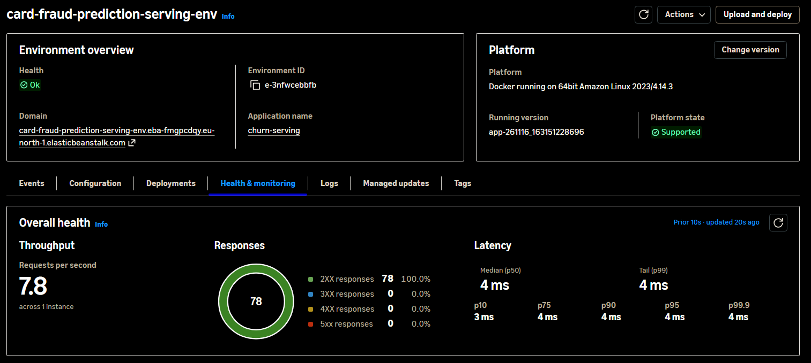
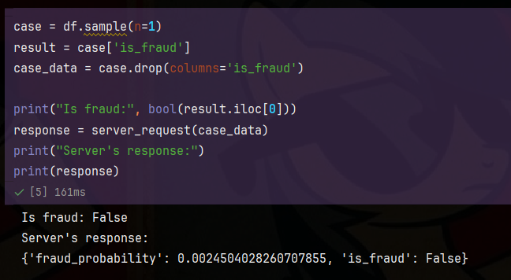

# Predicting Credit Card Fraud
 
Binary classification of card transactions (`is_fraud`) for the Kaggle **Playground Series S6E11** competition, packaged as an end-to-end ML project: EDA, model selection and tuning, a training script, a Flask prediction service, a Docker image and a deployment on AWS Elastic Beanstalk.
 
This is my midterm project for [ML Zoomcamp](https://github.com/DataTalksClub/machine-learning-zoomcamp) (DataTalks.Club).
 
- Competition: https://www.kaggle.com/competitions/playground-series-s6e11
- The competition data is based on the Kaggle dataset [Credit Card Fraud Detection 2026](https://www.kaggle.com/datasets/uditjain13/credit-card-fraud-detection-2026) by uditjain13.
- Best model: **XGBoost**, validation **ROC-AUC 0.9426**, PR-AUC 0.4906.
## Where to find each evaluation criterion
 
| Criterion | Where |
|---|---|
| Problem description | [Problem description](#problem-description) |
| EDA | [`EDA_and_modeling/00_EDA_first_view.ipynb`](EDA_and_modeling/00_EDA_first_view.ipynb), [`01_EDA_feature_analysis.ipynb`](EDA_and_modeling/01_EDA_feature_analysis.ipynb) |
| Model training and tuning | notebooks [`10`](EDA_and_modeling/10_model_simple_regression.ipynb) (logistic regression), [`11`](EDA_and_modeling/11_model_tree.ipynb) (decision tree), [`12`](EDA_and_modeling/12_model_random_forest.ipynb) (random forest), [`13`](EDA_and_modeling/13_model_xgb.ipynb) (XGBoost) |
| Notebook exported to script | [`solution_and_deployment/final_model.py`](solution_and_deployment/final_model.py) |
| Reproducibility | [How to reproduce](#how-to-reproduce) (data is included in `data/`) |
| Model deployment | [`predicting_credit_card_fraud_server.py`](solution_and_deployment/deployment/predicting_credit_card_fraud_server.py) (Flask) |
| Dependency and environment management | [Pipenv setup](#1-environment-setup) |
| Containerization | [Docker](#5-run-with-docker) |
| Cloud deployment | [AWS Elastic Beanstalk](#6-cloud-deployment-aws-elastic-beanstalk) |
 
## Problem description
 
A payment processor sees thousands of card transactions every minute and has to decide, within milliseconds, which ones to let through, which to challenge (extra authentication, SMS/OTP, manual review) and which to block. Fraud is rare (**1.67%** of transactions in this data), so a rule such as "approve everything" is 98.3% accurate and completely useless. The goal is to give every transaction a **fraud probability** that ranks risky transactions above normal ones.
 
How the solution is used:
 
1. The transaction (amount, merchant category, card type, authentication method, device, velocity and mismatch signals, ...) is sent to the web service as JSON.
2. The service returns `fraud_probability` and a hard label `is_fraud`.
3. The business decides what happens next: approve, step-up authentication or manual review. The label threshold (`THRESHOLD = 0.1` in the server file) controls the balance between false alarms and missed fraud and should be set from their real costs.
The competition is scored with **ROC-AUC** on predicted probabilities, so the models are compared mainly by ROC-AUC and, because the classes are so imbalanced, also by **PR-AUC** (average precision; the no-skill baseline equals the fraud rate, about 0.017).
 
## Dataset
 
| | |
|---|---|
| Source | Kaggle Playground Series S6E11 (`train.csv`, `test.csv`) |
| Rows | 699,960 train, 299,984 test |
| Target | `is_fraud` (1 = fraud), 1.67% positives |
| Missing values | none |
| Features | 24: 13 numeric, 5 categorical, 6 boolean |
 
| Group | Features |
|---|---|
| Numeric | `amount_usd` (1 to 6,873), `hours_since_last_txn` (0.01 to 52), `txn_count_last_24h` (0 to 11), `distance_from_home_km` (0 to 58), `card_age_months` (25 to 73), `customer_age` (18 to 81), `account_balance_usd` (58 to 99,701), `cvv_retry_count` (0 to 3), `velocity_score` (0 to 73), `time_of_day_hour` (0 to 23), `day_of_week` (0 to 6), `merchant_risk_score` (0 to 100), `prior_disputes` (0 to 4) |
| Categorical | `merchant_category` (12 values), `card_type` (5), `auth_method` (5), `channel` (5), `device_type` (8) |
| Boolean | `is_foreign_transaction`, `is_new_merchant`, `used_vpn`, `ip_country_mismatch`, `billing_shipping_mismatch`, `is_ai_generated_scam_attempt` |
 
**Files in `data/`** (already committed, so nothing has to be downloaded):
 
| File | Content |
|---|---|
| `train_orig.csv`, `test_orig.csv` | the original Kaggle files |
| `train_1.csv`, `test_1.csv` | cleaned version created by `00_EDA_first_view.ipynb`: `id` dropped, text values lower-cased with spaces replaced by `_` |
| `solutions/` | Kaggle submission files written by the notebooks (not committed) |
 
To re-download the original files from Kaggle (needs the [Kaggle CLI](https://github.com/Kaggle/kaggle-api) and an API token):
 
```bash
kaggle competitions download -c playground-series-s6e11 -p data/
# unzip, then rename train.csv -> train_orig.csv and test.csv -> test_orig.csv
```
 
## EDA
 
- `00_EDA_first_view.ipynb`: shape, dtypes, `describe()`, missing values (none), target balance (1.67% fraud), text cleaning, export of `train_1.csv` / `test_1.csv`.
- `01_EDA_feature_analysis.ipynb`: feature types and distributions.
 
## Modeling
 
Data is split once with a stratified 60 / 20 / 20 split into train, validation and test (`random_state=42`). Categorical columns are one-hot encoded (`pd.get_dummies` + `DictVectorizer`). Four models were compared on the validation set:
 
| Model | Main settings | ROC-AUC | PR-AUC |
|---|---|---|---|
| Logistic regression (baseline) | defaults | 0.7502 | 0.0636 |
| Decision tree | `max_depth=11`, `min_samples_leaf=30` | 0.8996 | 0.3658 |
| Random forest | 1000 trees, `max_depth=16`, `min_samples_leaf=10` | 0.9317 | 0.4539 |
| **XGBoost** | `eta=0.05`, `max_depth=6`, `min_child_weight=35`, 1000 rounds | **0.9426** | **0.4906** |
 
Hyperparameter search (loops are in the notebooks; set `PARAMETERS_ADJUSTMENT = True` to re-run them):
 
- Decision tree: grid over `max_depth` 1 to 19 and `min_samples_leaf` 1 to 46.
- Random forest: grid over `max_depth` 5 to 19 and `min_samples_leaf` 1 to 196 (10 trees while searching, 1000 for the final model).
- XGBoost: one parameter at a time, scored by validation AUC: `eta` in {0.01, 0.05, 0.1, 0.3, 1.0}, then `max_depth` 1 to 9, then `min_child_weight` 1 to 96.
`_evaluating.py` also draws the precision-recall curve and runs a bootstrap noise check of PR-AUC.
 
**Kaggle public leaderboard score:** **0.94645** (ROC-AUC of `data/solutions/solution_final.csv`).
 
## Repository structure
 
```
.
├── README.md
├── Pipfile, Pipfile.lock           # environment for notebooks, training and local service
├── data/                           # train/test CSV files (see above)
├── EDA_and_modeling/
│   ├── 00_EDA_first_view.ipynb
│   ├── 01_EDA_feature_analysis.ipynb
│   ├── 10_model_simple_regression.ipynb
│   ├── 11_model_tree.ipynb
│   ├── 12_model_random_forest.ipynb
│   ├── 13_model_xgb.ipynb
│   └── functional_files/           # helpers: data loading, features, metrics, model save/load
├── solution_and_deployment/
│   ├── final_model.py              # training script: trains the final XGBoost model and saves it
│   ├── prediction_request.ipynb    # client that calls the service (local or cloud)
│   └── deployment/
│       ├── predicting_credit_card_fraud_server.py   # Flask service (POST /predict)
│       ├── final_model.bin         # DictVectorizer + XGBoost model (created by final_model.py)
│       ├── Dockerfile
│       ├── Pipfile, Pipfile.lock   # minimal dependencies for the container
│       └── .dockerignore
└── images/                         # screenshots used in this README
```
 
## How to reproduce
 
Requirements: Python 3.13 or newer, [Pipenv](https://pipenv.pypa.io/), Docker (only for the container part) and the EB CLI (only for the cloud part). Pandas 3 is required: the cleaning step in notebook 00 relies on its `str` dtype and silently does nothing on pandas 2.
 
### 1. Environment setup
 
```bash
git clone https://github.com/Timon-NEON/kaggle_competition_s6e11_Predicting_Credit_Card_Fraud
cd kaggle_competition_s6e11_Predicting_Credit_Card_Fraud
 
pip install pipenv
pipenv install --dev      # creates a virtual environment and installs the locked versions
pipenv shell              # activate it (type `exit` to leave)
```
 
`pipenv install --dev` installs everything (training, notebooks, local service). The same commands work in PowerShell and in bash. Create the output folders once (they are git-ignored, so they do not exist after cloning):
 
```bash
python -c "from pathlib import Path; [Path(p).mkdir(parents=True, exist_ok=True) for p in ('EDA_and_modeling/models', 'data/solutions')]"
```
 
### 2. Notebooks (EDA and model selection)
 
```bash
cd EDA_and_modeling
jupyter lab
```
 
Run the notebooks in this order: `00` (creates `train_1.csv` and `test_1.csv`), `01`, then `10` to `13`. Start Jupyter from `EDA_and_modeling/`, because the notebooks read `../data/` and import `functional_files`.
 
### 3. Train the final model
 
```bash
cd solution_and_deployment
python final_model.py
```
 
It trains XGBoost on all of `train_1.csv`, saves the vectorizer and the model to `deployment/final_model.bin` and writes the Kaggle submission `data/solutions/solution_final.csv`. Training 1000 boosting rounds on 700k rows can take several minutes.
 
### 4. Run the service locally
 
```bash
cd solution_and_deployment/deployment
 
# Linux / macOS / WSL
gunicorn --bind 0.0.0.0:9696 predicting_credit_card_fraud_server:app
 
# any OS (Flask development server)
python predicting_credit_card_fraud_server.py
```
 
Send a request (`requests` is installed with `--dev`):
 
```python
import requests
 
case = {
    "amount_usd": 61.16, "hours_since_last_txn": 9.77, "txn_count_last_24h": 1,
    "distance_from_home_km": 17.78, "card_age_months": 48, "customer_age": 56,
    "account_balance_usd": 1269.35, "cvv_retry_count": 0, "velocity_score": 5.5,
    "time_of_day_hour": 17, "day_of_week": 3, "merchant_risk_score": 29.2,
    "prior_disputes": 0, "merchant_category": "groceries", "card_type": "mastercard",
    "auth_method": "otp", "channel": "pos", "device_type": "iphone",
    "is_foreign_transaction": False, "is_new_merchant": False, "used_vpn": False,
    "ip_country_mismatch": False, "billing_shipping_mismatch": False,
    "is_ai_generated_scam_attempt": False,
}
print(requests.post("http://localhost:9696/predict", json=case).json())
# {'fraud_probability': 0.0028, 'is_fraud': False}   (values depend on the trained model)
```
 
`POST /predict` takes one JSON object with the 24 features and returns `fraud_probability` (float) and `is_fraud` (`fraud_probability >= 0.1`). Use the same spelling as in `train_1.csv`: lower-case text with `_` instead of spaces (`online_retail`, `3d_secure`, `in-app`). Unknown values are silently ignored by the encoder. You can also send requests with the client notebook described next.
 
#### Client notebook: `prediction_request.ipynb`
 
`solution_and_deployment/prediction_request.ipynb` sends real rows from `data/train_1.csv` to the service and shows the answers. It works the same for the local service, the Docker container and the cloud deployment; only the address changes.
 
1. Start a service first: locally (this step), with Docker ([step 5](#5-run-with-docker)) or use the cloud one ([step 6](#6-cloud-deployment-aws-elastic-beanstalk)).
2. Start Jupyter from the notebook's folder, because it reads `../data/train_1.csv`:
```bash
cd solution_and_deployment
jupyter lab
```
 
3. Open the notebook and find the cell with `post_url`. Keep exactly **one** address active. For the local service or the Docker container:
```python
# Local link
post_url = 'http://localhost:9696/predict'
 
# Global link (Elastic Beanstalk)
# post_url = 'http://card-fraud-prediction-serving-env.eba-fmgpcdqy.eu-north-1.elasticbeanstalk.com/predict'
```
 
   For the public cloud link, do the opposite: comment out the local line and un-comment the global one. (In the committed notebook the global link is the active one.)
4. Run the cells from top to bottom:
   - **One request:** takes a random row, prints its real label (`Is fraud: ...`) and the server's answer, for example `{'fraud_probability': 0.0028, 'is_fraud': False}`.
   - **Multiple requests:** sends 500 random rows one by one (progress is printed every 100) and shows a confusion matrix as shares of the 500 requests: rows are the real class (not fraud, fraud), columns are the predicted label at the 0.1 threshold, so `[[true negatives, false positives], [false negatives, true positives]]`. The requests are sent one after another, so the cloud link is slower than localhost; lower `N` for a quick check.
The rows come from the training file, so this notebook checks that the service works end to end. It is not a measure of model quality; for that see [Modeling](#modeling).
 
### 5. Run with Docker
 
`deployment/final_model.bin` must exist (step 3).
 
```bash
cd solution_and_deployment/deployment
docker build -t card-fraud-service .
docker run -it --rm -p 9696:9696 card-fraud-service
```
 
The image uses `python:3.14-slim`, installs the locked dependencies from `Pipfile.lock` (`pipenv install --system --deploy`) and starts the service with gunicorn on port 9696. Test it with the request above or with the [client notebook](#client-notebook-prediction_requestipynb) using the localhost address.
 
### 6. Cloud deployment (AWS Elastic Beanstalk)
 
The Docker image is run by Elastic Beanstalk (EB) on a single EC2 instance in `eu-north-1` (Stockholm). EB builds the Dockerfile from the files **committed** in `solution_and_deployment/deployment/`, so commit `final_model.bin` first.
 
```bash
cd solution_and_deployment/deployment
pipenv install --dev                 # installs the EB CLI (awsebcli, a dev-only tool)
pipenv shell
 
eb init -p docker -r eu-north-1 card-fraud-prediction-serving
eb local run --port 9696             # optional: run the container locally through EB
eb create card-fraud-prediction-serving-env --single
eb status                            # shows the public URL (CNAME)
eb terminate card-fraud-prediction-serving-env   # stop paying when you are done
```
 
You need an AWS account and an IAM user with the `AdministratorAccess-AWSElasticBeanstalk` policy; `eb init` asks for its access key. `--single` creates one instance without a load balancer, which is cheaper.
 
Deployed service (may be offline when you read this, to save cost): `http://card-fraud-prediction-serving-env.eba-fmgpcdqy.eu-north-1.elasticbeanstalk.com/predict`
 
To test it, send the request from [step 4](#4-run-the-service-locally) to this address, or set `post_url` in the [client notebook](#client-notebook-prediction_requestipynb) to it.
 
Evidence that the cloud deployment works:
 

 

 
The output of the requests to the cloud URL is also saved in `solution_and_deployment/prediction_request.ipynb`.
 
## Limitations and next steps
 
- Models are compared on one validation split; there is no cross-validation yet.
- The logistic regression baseline uses unscaled features and default settings.
- The 0.1 decision threshold is a fixed constant, not tuned to a cost matrix.
- Only one-hot encoding is used. Feature engineering (ratios such as amount to balance, interaction features) and an XGBoost / LightGBM ensemble are the next things to try.
## License
 
MIT, see [LICENSE](LICENSE).
 